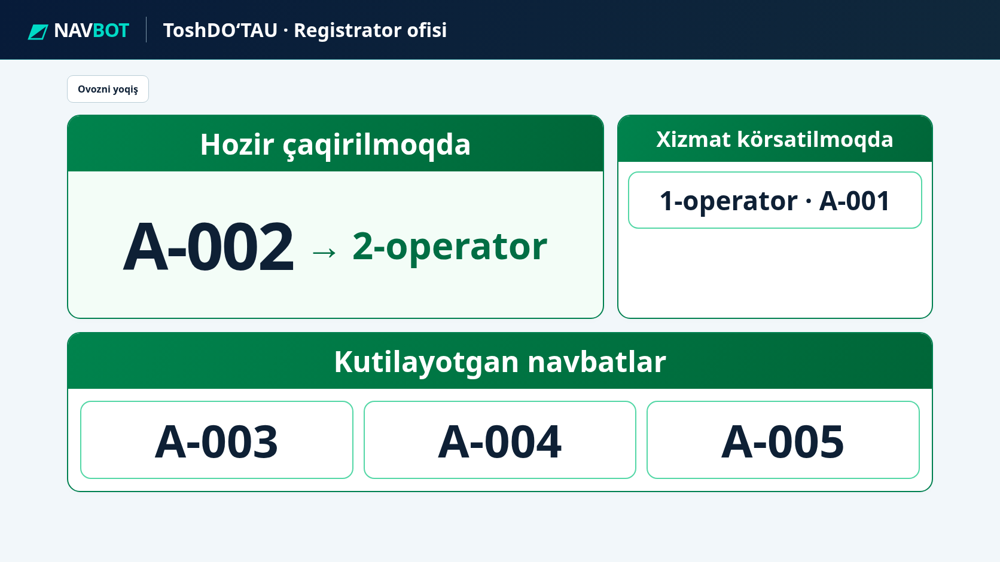

# NavBoT — v0.5 lokal ishchi sinov

ToshDO‘TAU Registrator ofisi: navbat, murojaatlar reyestri va ijro nazorati.
Talab manbasi: [0.5 hujjati](docs/requirements-v0.5.txt). Kiosk, TV, tablo va kabinetlar navy/teal dizayn namunalariga moslashtirilgan.

## Windowsda ishga tushirish

1. GitHubda **Code → Download ZIP** ni bosing; ZIPni to‘liq yangi papkaga oching.
2. [Python 3.12 yoki yangiroq](https://www.python.org/downloads/windows/) o‘rnating; **Add Python to PATH** ni belgilang.
3. `START-WINDOWS.bat` faylini oching. Server oynasini yopmang.
4. Chrome yoki Edge brauzerida quyidagi manzillarni oching.

| Oyna | Manzil |
| --- | --- |
| Kiosk | http://127.0.0.1:8081/kiosk |
| Xodim kirishi | http://127.0.0.1:8081/login |
| Menejer/operator | http://127.0.0.1:8081/operator |
| TV | http://127.0.0.1:8081/tv |
| 1-oyna tablosi | http://127.0.0.1:8081/tablo?id=1 |

**Faqat lokal sinov hisoblari** (`--seed-demo` bilan yaratiladi):

| Login | Rol |
| --- | --- |
| `admin` | Superadmin |
| `manager` | 1-operator menejeri |
| `manager2` | 2-operator menejeri |
| `executor` | O‘quv bo‘limi ijrochisi |
| `head` | O‘quv bo‘limi boshlig‘i |
| `director` | Direktor / umumiy hisobot |

Hammasining dastlabki sinov paroli: `Navbot-Test-2026!`. O‘zgartirilgan parol qayta ishga tushirganda tiklanmaydi.
Talaba sinov IDlari: `100000000001`, `100000000002`, `H24011876`. Bular haqiqiy talabalar emas.
Profil orqali parol almashtirilganda barcha sessiyalar yopiladi, yangi parol bilan qayta kiring.

## Linux/macOS

Ilova Python standart kutubxonalarida ishlaydi, tashqi paket kerak emas:

```sh
cd /workspace/NavBot
python3 navbot/app.py --port 8081 --db navbot/navbot.sqlite3 --seed-demo
```

Bu loopbackdagi lokal pilot. Jismoniy kiosk/TV, umumiy LAN va tashqi HTTPS uchun [Ubuntu yo‘riqnomasi](deploy/UBUNTU.md) va haqiqiy uskunalarda alohida qabul sinovi kerak.

## Ishchi jarayon

Kioskda til → bo‘lim → xizmat → chek. Menejer o‘z loginida navbatni chaqiradi; TV va tegishli tablo yangilanadi. Qabulni boshlash TVning xizmat ko‘rsatilmoqda qismiga juftlik qo‘shadi. Qabulni tugatish jismoniy navbatni tugatadi; **ariza alohida saqlanadi**.

Menejer HEMIS ID bilan talabani topib arizaga biriktiradi, mazmun/izohni saqlaydi. Joyida hal qilish yoki muddat va ichki asos bilan mas’ulga yuborish mumkin. Ijrochi sabab bilan menejerga qaytaradi yoki javobni tasdiqqa yuboradi. Bo‘lim boshlig‘i tasdiqlaydi yoki izoh bilan tuzatishga qaytaradi. Qayta yo‘naltirishda raqam va amaldagi muddat saqlanadi. Faqat vakolatli rahbar muddatni sabab bilan o‘zgartiradi; tarixda oldingi/yangi sana va asos qoladi.

Telefon orqali murojaatni menejer talaba shaxsini tasdiqlaganini belgilab kiritadi; unga chek, kiosk navbati yoki TV chaqiruvi yaratilmaydi. Bu belgi avtomatik shaxs tasdig‘i emas: universitet tasdiqlash tartibini belgilashi kerak.

Hisobot bazadagi yozuvlardan hisoblanadi. Filtrlar, bo‘limlar kesimi, arxiv va UTF-8 CSV eksport mavjud. Tashqi jadvalga eksportda formula kiritish himoyasi ishlaydi.

## Saqlash va yangilash

Baza `navbot/navbot.sqlite3` ichida; o‘chirmang yoki yangi ZIP bilan almashtirmang. Serverni Ctrl+C bilan to‘xtatib yangilang. Birinchi v0.5 migratsiyasidan oldin SQLite backup API orqali `.pre-v05-….bak` nusxasi olinadi. Oldingi chek/student/call yozuvlari qoladi. Eski cheklarda vaqt bo‘lmagan: import vaqtini haqiqiy qabul vaqti deb qabul qilmang, tarixda `legacy_import` belgisi bor.

Bazani ko‘chirish/zaxiralash: serverni to‘xtating, `.sqlite3`, mavjud bo‘lsa `.sqlite3-wal` va `.sqlite3-shm` fayllarini birga saqlang yoki SQLite backup API ishlating. Qaytishda eski kod va unga mos to‘liq baza zaxirasini birga tiklang; ishlayotgan bazani qisman almashtirmang.

Demo hisoblarsiz birinchi admin yaratish:

```sh
python3 navbot/app.py --db navbot/production.sqlite3 --init-admin
```

Login/parol terminalda kiritiladi. Keyin ayni baza bilan `--init-admin` va `--seed-demo`siz serverni ishga tushiring. Vaqtinchalik parol birinchi kirishda almashtiriladi. Demo bazani ishlab chiqarish bazasi sifatida ishlatmang.

## Talabalar fayli

Superadmin paneli orqali JSON fayldan yuklash (1–10000 yozuv). Misol:

```json
{"students":[{"hemis_id":"H24011876","full_name":"Sinov Talaba","faculty":"Filologiya","programme":"Özbek tili","course":3,"student_group":"TEST-301","education_form":"Kunduzgi","status":"active"}]}
```

Import HEMIS ID bo‘yicha yangilaydi/qo‘shadi. Bir xato bo‘lsa butun import qaytariladi; oldingi ma’lumotlar saqlanadi. Qidiruv internetga bog‘liq emas.

## Tekshirish

```sh
python3 -m unittest discover -s tests -p 'test_*.py' -v
```

Bu testlar vaqtinchalik bazalarda haqiqiy HTTP server hamda SQLite bilan autentifikatsiya, vakolat, parallel holat versiyasi, ariza oqimi, import, hisobot va migratsiyani tekshiradi.

Playwright va Chromium o‘rnatilgan muhitda, alohida bo‘sh demo bazasidagi serverga qarshi:

```sh
NAVBOT_URL=http://127.0.0.1:8081 node tests/queue-browser.cjs
NAVBOT_URL=http://127.0.0.1:8081 node tests/student-browser.cjs
```

Ovoz testlari Speech APIga til/matn yuborilishini tekshiradi. Haqiqiy karnay, Windowsdagi ovozlar, 80 mm printer va Info KeyOS ushbu avtomatik testlarga kirmaydi.

## Tashqi ulanishlar va hali bajarilmagan qismlar

Lokal panel bildirishnomalari serverdan davriy tekshiriladi. Ular Telegram yoki OS push emas. **LMS/HEMIS API va Telegram hali ulanmagan**; UI ularni ulangan deb ko‘rsatmaydi. Tasdiqlangan akkaunt bog‘lash, bot javobi/baholash, yuborilmagan xabarlarni qayta jo‘natish, LMS ID deduplikatsiyasi va sinxronizatsiya tashqi API/bot shartnomalari va xavfsiz kiritilgan ruxsatlar bilan keyingi qabul bosqichida bajariladi.

Yakuniy ariza shablonlari, tasdiqlangan xizmat/rol/muddat matritsasi va huquqiy asoslar hali berilmagan. Hozirgi rollar oldindan belgilangan, katalog 5×5 nomlarini/tarjimalarini tahrirlash va xizmat yashirish mumkin; cheklanmagan rol konstruktorlari, shablon fayllari versiyalash va qurilma protokollari hali tayyor emas. Demo tarixida yoki blankalarda tasdiqlanmagan qonun moddasi avtomatik huquqiy asos sifatida ishlatilmaydi.

Qabul dalillari va talablar qamrovi: [docs/ACCEPTANCE.md](docs/ACCEPTANCE.md).

## Ekranlardan namuna



[Kiosk](docs/previews/kiosk.png) · [Menejer](docs/previews/manager.png)
