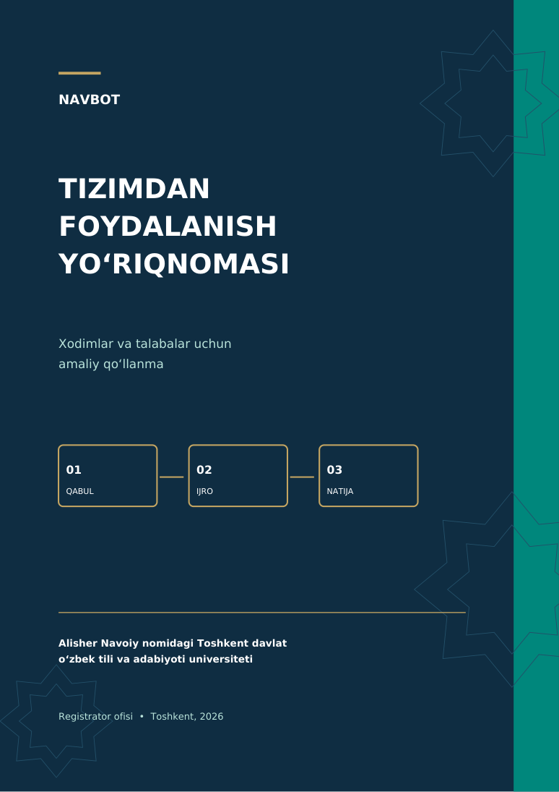

# NAVBOT — kitob nashri

27-noyabr 2026-yil • A4 • 48 sahifa • 4 bo‘lim • 20 bob.

**[To‘liq kitobni ochish — PDF](NAVBOT-KITOB.pdf)**

**[Bosmaxona uchun barcha fayllar — ZIP](NAVBOT-KITOB-BOSMA-PAKET.zip)**

GitHubda faylni oching va yuqoridagi **Download raw file** tugmasini bosing.

| Fayl | Maqsadi |
| --- | --- |
| [NAVBOT-KITOB.pdf](NAVBOT-KITOB.pdf) | To‘liq 48 sahifali kitob, old/orqa muqova bilan |
| [NAVBOT-ICHKI-SAHIFALAR.pdf](NAVBOT-ICHKI-SAHIFALAR.pdf) | Muqovani alohida bosish uchun 44 ichki sahifa |
| [NAVBOT-MUQOVA-3MM.pdf](NAVBOT-MUQOVA-3MM.pdf) | Old va orqa tashqi muqova: A4 + 3 mm kesish zaxirasi |
| [NAVBOT-KITOB.docx](NAVBOT-KITOB.docx) | Matnni tahrirlash uchun Word nusxasi |
| [CHOP-ETISH.txt](CHOP-ETISH.txt) | Bosmaxona va oddiy printer uchun ko‘rsatma |

Ichki/tashqi hoshiyalar: 26/18 mm. Muqovaning ichki tomonlari bo‘sh. To‘liq faylda 1-bet old muqova, 2-bet bo‘sh; 3–46 ichki sahifalar; 47-bet bo‘sh, 48-bet orqa muqova. O‘zak eni qog‘oz va muqovalash usuliga qarab bosmaxonada belgilanadi. Maket RGB; bosmaxona rang profiliga mos konvertatsiya va montajni bajaradi. Word qayta sahifalanishi mumkin — chop uchun PDF asosiy.

